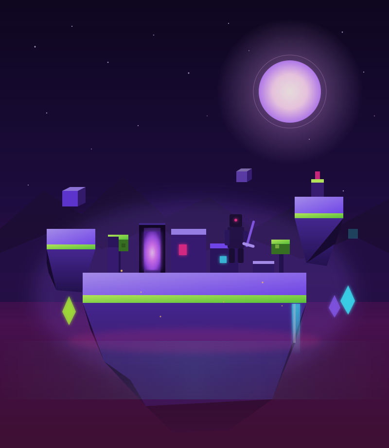

<!DOCTYPE html>
<html lang="ru">
<head>
<meta charset="UTF-8">
<meta name="viewport" content="width=device-width, initial-scale=1.0">
<title>FunTime COPY — анархия-сервер. Цены в 20 раз ниже</title>
<meta name="description" content="FunTime COPY — неофициальная копия FunTime. Те же режимы, кейсы и привилегии, но цены в 20 раз ниже. Анархия 101, дуэли, казино.">
<meta name="theme-color" content="#08060f">
<link rel="preconnect" href="https://fonts.googleapis.com">
<link rel="preconnect" href="https://fonts.gstatic.com" crossorigin>
<link href="https://fonts.googleapis.com/css2?family=Unbounded:wght@400;600;700;800;900&family=Inter:wght@400;500;600;700;800&display=swap" rel="stylesheet">
<link rel="stylesheet" href="assets/styles.css">
<link rel="icon" href="data:image/svg+xml,%3Csvg xmlns='http://www.w3.org/2000/svg' viewBox='0 0 32 32'%3E%3Crect width='32' height='32' rx='7' fill='%230b0912'/%3E%3Crect x='7' y='7' width='8' height='8' fill='%238b5cf6'/%3E%3Crect x='17' y='7' width='8' height='8' fill='%23ff2f8d'/%3E%3Crect x='7' y='17' width='8' height='8' fill='%2338e8ff'/%3E%3Crect x='17' y='17' width='8' height='8' fill='%23b6ff3a'/%3E%3C/svg%3E">
</head>
<body>

  

  

  

  

  

<header class="header" id="header">
  

    <a class="logo" href="#top" aria-label="FunTime COPY — на главную">
      <i></i><i></i><i></i><i></i>
      
        FUNTIMECOPY
        KochTime project
      
    </a>

    <nav class="nav" id="nav" aria-label="Основная навигация">
      <a href="#shop" class="nav__link">Магазин</a>
      <a href="#modes" class="nav__link">Режимы</a>
      <a href="#why" class="nav__link">Почему дешевле</a>
      <a href="#faq" class="nav__link">FAQ</a>
      <a href="#support" class="nav__link">Сервер</a>
      <a href="#shop" class="btn btn--sm btn--primary nav__cta">Играть</a>
    </nav>

    

      <button class="cart-btn" data-open-cart aria-label="Открыть корзину">
        <svg viewBox="0 0 24 24" width="18" height="18" fill="none" stroke="currentColor" stroke-width="1.8"><path d="M3 4h2l2.4 11.2a2 2 0 0 0 2 1.6h7.8a2 2 0 0 0 2-1.6L21 7H6"/><circle cx="10" cy="20" r="1.4"/><circle cx="18" cy="20" r="1.4"/></svg>
        0
      </button>
      <button class="burger" id="burger" aria-label="Открыть меню" aria-expanded="false" aria-controls="nav">
        
      </button>
    

  

</header>

<main id="top">

  <!-- HERO -->
  <section class="hero">
    

      

        

          1:1 копия FunTime
          цены ÷ 20
          неофициальный фан-проект
        

        <h1 class="hero__title reveal">
          Тот же FunTime. 
          Только в 20 раз 
          дешевле.
        </h1>

        

          Анархия 101, кланы, аукцион, трапы и кейсы — всё как на оригинале.
          Мы не платим за бренд, поэтому привилегии, кейсы и валюта стоят
          ровно <b>в двадцать раз меньше</b>.
        

        

          <a href="#shop" class="btn btn--primary btn--lg">Смотреть магазин</a>
          <a href="#modes" class="btn btn--ghost btn--lg">Как играть</a>
          <a href="https://zxc458675.github.io/kochtime.github.io/" class="btn btn--ghost btn--lg" target="_blank" rel="noopener">Наш сайт</a>
        

        <button class="ip-card reveal" id="ipCard" data-ip="chords-ivory.tun.ply.gg">
          IP сервера
          chords-ivory.tun.ply.gg
          
            <svg viewBox="0 0 24 24" width="16" height="16" fill="none" stroke="currentColor" stroke-width="2"><rect x="9" y="9" width="13" height="13" rx="2"/><path d="M5 15V5a2 2 0 0 1 2-2h10"/></svg>
            копировать
          
        </button>

        

          
<b>99,9%</b>аптайм за месяц

          
<b>56 214</b>кейсов открыто

          
<b>×20</b>дешевле оригинала

        

      

      

        

          
          

        

        

          Скидка на всё
          <b>-95%</b>
        

        

          Топ-ранг
          <b>139,95 ₽</b>
          <s>2 799 ₽</s>
        

      

    

    

      

        Копия FunTime<i>◆</i>Привилегии ÷20<i>◆</i>Кейсы — 5 ₽<i>◆</i>
        Анархия 101<i>◆</i>250 слотов<i>◆</i>Без вайпов<i>◆</i>
        Копия FunTime<i>◆</i>Привилегии ÷20<i>◆</i>Кейсы — 5 ₽<i>◆</i>
        Анархия 101<i>◆</i>250 слотов<i>◆</i>Без вайпов<i>◆</i>
      

    

  </section>

  <!-- SHOP -->
  <section class="section" id="shop">
    

      

        Магазин
        <h2 class="section__title">Прайс в токенах</h2>
        

          Курс простой: <b>10 000 токенов = 10 ₽</b>, то есть 1 000 токенов за рубль.
          Никаких скрытых наценок. Оплата на DonateX.
        

      

      <!-- CALCULATOR -->
      

        

          Калькулятор
          <h3>Посчитай донат за 5 секунд</h3>
          
Введи токены или рубли — сумма пересчитается сама.

        

        

          

            <label class="calc__lab" for="tokInput">Токены</label>
            

              <input id="tokInput" type="number" min="0" step="1000" value="10000" inputmode="numeric">
              токенов
            

            <input type="range" id="tokRange" class="range" min="0" max="2000000" step="1000" value="10000" aria-label="Количество токенов">
            

              <button type="button" data-tok="1000">1 000</button>
              <button type="button" data-tok="5000">5 000</button>
              <button type="button" data-tok="10000">10 000</button>
              <button type="button" data-tok="50000">50 000</button>
              <button type="button" data-tok="100000">100 000</button>
            

          

          
=

          

            <label class="calc__lab" for="rubInput">К оплате, ₽</label>
            

              <input id="rubInput" type="number" min="0" step="1" value="10" inputmode="decimal">
              ₽
            

            
10 000 токенов · 10 ₽

            <a class="btn btn--primary btn--block" href="https://donatex.gg/donate/zwezdak22" target="_blank" rel="noopener" id="calcPay">
              Оплатить на DonateX
            </a>
          

        

        

          Оплата проходит на DonateX. В комментарии к платежу укажи свой ник —
          токены зачислим в течение 5 минут.
        

      

      

        <b>1 000</b> токенов = <b>1</b> ₽
        <b>10 000</b> токенов = <b>10</b> ₽
        <a href="https://donatex.gg/donate/zwezdak22" target="_blank" rel="noopener">DonateX ↗</a>
      

      

        <button class="tab is-active" role="tab" aria-selected="true" data-tab="priv">Привилегии 11</button>
        <button class="tab" role="tab" aria-selected="false" data-tab="cases">Кейсы 50</button>
        <button class="tab" role="tab" aria-selected="false" data-tab="coins">Токены</button>
        <button class="tab" role="tab" aria-selected="false" data-tab="misc">Услуги</button>
      

      

        

          Срок привилегии
          

            <button type="button" class="term is-active" data-term="30">30 дней</button>
            <button type="button" class="term" data-term="90">90 дней</button>
            <button type="button" class="term" data-term="forever">Навсегда</button>
          

          цена пересчитывается автоматически
        

        

          <article class="card" data-id="baron" data-name="Барон" data-price="2.45" data-old="49" data-tokens="2450">
            
I ступень−95%

            <h3 class="card__name">Барон</h3>
            
Старт: зарплата, смена позы и первые плюшки.

            <ul class="card__list">
              <li>Префикс <b>[Барон]</b> в чате и табе</li>
              <li>/kit baron — набор Барона</li>
              <li>/salary — зарплата</li>
              <li>/crawl — смена позы</li>
              <li>2 точки дома · 6 слотов аукциона</li>
            </ul>
            
<b>2,45 ₽</b><s>49 ₽</s>

            
2 450 токенов · 30 дней

            <button class="btn btn--primary btn--block" data-add>В корзину</button>
          </article>

          <article class="card" data-id="strazh" data-name="Страж" data-price="4.45" data-old="89" data-tokens="4450">
            
II ступень−95%

            <h3 class="card__name">Страж</h3>
            
Чуть больше дома и быстрее телепорт.

            <ul class="card__list">
              <li>Префикс <b>[Страж]</b> в чате и табе</li>
              <li>/kit strazh — набор Стража</li>
              <li>/salary — повышенная зарплата</li>
              <li>3 точки дома · 8 слотов аукциона</li>
              <li>Задержка телепорта 6 сек</li>
            </ul>
            
<b>4,45 ₽</b><s>89 ₽</s>

            
4 450 токенов · 30 дней

            <button class="btn btn--primary btn--block" data-add>В корзину</button>
          </article>

          <article class="card" data-id="geroy" data-name="Герой" data-price="6.95" data-old="139" data-tokens="6950">
            
III ступень−95%

            <h3 class="card__name">Герой</h3>
            
Универсальный ранг для активной игры.

            <ul class="card__list">
              <li>Префикс <b>[Герой]</b> в чате и табе</li>
              <li>/kit geroy — набор Героя</li>
              <li>/salary и /crawl</li>
              <li>4 региона · 10 слотов аукциона</li>
              <li>Задержка телепорта 5 сек</li>
            </ul>
            
<b>6,95 ₽</b><s>139 ₽</s>

            
6 950 токенов · 30 дней

            <button class="btn btn--primary btn--block" data-add>В корзину</button>
          </article>

          <article class="card" data-id="aspid" data-name="Аспид" data-price="8.95" data-old="179" data-tokens="8950">
            
IV ступень−95%

            <h3 class="card__name">Аспид</h3>
            
Больше регионов и почти нет задержки.

            <ul class="card__list">
              <li>Префикс <b>[Аспид]</b> в чате и табе</li>
              <li>/kit aspid — набор Аспида</li>
              <li>/salary, /crawl, /hat</li>
              <li>5 регионов · 14 слотов аукциона</li>
              <li>Задержка телепорта 4 сек</li>
            </ul>
            
<b>8,95 ₽</b><s>179 ₽</s>

            
8 950 токенов · 30 дней

            <button class="btn btn--primary btn--block" data-add>В корзину</button>
          </article>

          <article class="card card--featured" data-id="skvid" data-name="Сквид" data-price="13.95" data-old="279" data-tokens="13950">
            выбор игроков
            
V ступень−95%

            <h3 class="card__name">Сквид</h3>
            
Средний ранг: комфорт без переплаты.

            <ul class="card__list">
              <li>Префикс <b>[Сквид]</b> + цвет ника</li>
              <li>/kit skvid — усиленный набор</li>
              <li>6 регионов · 18 слотов аукциона</li>
              <li>/back после смерти</li>
              <li>Задержка телепорта 3 сек</li>
            </ul>
            
<b>13,95 ₽</b><s>279 ₽</s>

            
13 950 токенов · 30 дней

            <button class="btn btn--primary btn--block" data-add>В корзину</button>
          </article>

          <article class="card" data-id="glava" data-name="Глава" data-price="18.95" data-old="379" data-tokens="18950">
            
VI ступень−95%

            <h3 class="card__name">Глава</h3>
            
Регионы, жирный кит и быстрый телепорт.

            <ul class="card__list">
              <li>Префикс <b>[Глава]</b> + свечение</li>
              <li>/kit glava — набор Главы</li>
              <li>8 регионов · 22 слота аукциона</li>
              <li>5 кейсов «Легендарный» в подарок</li>
            </ul>
            
<b>18,95 ₽</b><s>379 ₽</s>

            
18 950 токенов · 30 дней

            <button class="btn btn--primary btn--block" data-add>В корзину</button>
          </article>

          <article class="card" data-id="elita" data-name="Элита" data-price="28.95" data-old="579" data-tokens="28950">
            
VII ступень−95%

            <h3 class="card__name">Элита</h3>
            
Для тех, кто живёт на сервере, а не заходит.

            <ul class="card__list">
              <li>Префикс <b>[Элита]</b> с градиентом</li>
              <li>/kit elita — набор Элиты</li>
              <li>10 регионов · 26 слотов аукциона</li>
              <li>10 кейсов «FunTime» в подарок</li>
            </ul>
            
<b>28,95 ₽</b><s>579 ₽</s>

            
28 950 токенов · 30 дней

            <button class="btn btn--primary btn--block" data-add>В корзину</button>
          </article>

          <article class="card" data-id="titan" data-name="Титан" data-price="38.95" data-old="779" data-tokens="38950">
            
VIII ступень−95%

            <h3 class="card__name">Титан</h3>
            
Почти максимум: всё быстрее и больше.

            <ul class="card__list">
              <li>Префикс <b>[Титан]</b> + анимация</li>
              <li>/kit titan — набор Титана</li>
              <li>14 регионов · 30 слотов аукциона</li>
              <li>15 кейсов «FunTime» в подарок</li>
            </ul>
            
<b>38,95 ₽</b><s>779 ₽</s>

            
38 950 токенов · 30 дней

            <button class="btn btn--primary btn--block" data-add>В корзину</button>
          </article>

          <article class="card" data-id="prints" data-name="Принц" data-price="48.95" data-old="979" data-tokens="48950">
            
IX ступень−95%

            <h3 class="card__name">Принц</h3>
            
Королевский набор возможностей.

            <ul class="card__list">
              <li>Префикс <b>[Принц]</b> + частицы</li>
              <li>Все киты предыдущих рангов</li>
              <li>16 регионов · 35 слотов аукциона</li>
              <li>Приоритетный вход на сервер</li>
              <li>20 кейсов «FunTime» в подарок</li>
            </ul>
            
<b>48,95 ₽</b><s>979 ₽</s>

            
48 950 токенов · 30 дней

            <button class="btn btn--primary btn--block" data-add>В корзину</button>
          </article>

          <article class="card" data-id="knyaz" data-name="Князь" data-price="64.95" data-old="1299" data-tokens="64950">
            
X ступень−95%

            <h3 class="card__name">Князь</h3>
            
Максимум без компромиссов.

            <ul class="card__list">
              <li>Префикс <b>[Князь]</b> + звук входа</li>
              <li>Все киты + /kit knyaz</li>
              <li>20 регионов · 40 слотов аукциона</li>
              <li>Телепорт без задержки</li>
              <li>30 кейсов «FunTime» в подарок</li>
            </ul>
            
<b>64,95 ₽</b><s>1 299 ₽</s>

            
64 950 токенов · 30 дней

            <button class="btn btn--primary btn--block" data-add>В корзину</button>
          </article>

          <article class="card card--ultra" data-id="gercog" data-name="Герцог" data-price="139.95" data-old="2799" data-tokens="139950">
            топ сервера
            
XI ступень−95%

            <h3 class="card__name">Герцог</h3>
            
Максимальный ранг. Все возможности сервера.

            <ul class="card__list">
              <li>Уникальный префикс <b>[Герцог]</b></li>
              <li>Все киты и все команды</li>
              <li>Безлимит регионов и слотов аукциона</li>
              <li>/tp без задержки</li>
              <li>50 кейсов «FunTime» в подарок</li>
              <li>Личный менеджер поддержки</li>
            </ul>
            
<b>139,95 ₽</b><s>2 799 ₽</s>

            
139 950 токенов · 30 дней

            <button class="btn btn--primary btn--block" data-add>В корзину</button>
          </article>

        

        

          По умолчанию привилегии покупаются на <b>30 дней</b>. Переключатель срока над карточками
          пересчитывает цену: 90 дней — ×2, «Навсегда» — ×8. Токены списываются по курсу
          1 000 токенов = 1 ₽.
        

      

      

        <article class="case-bundle case-bundle--solo" data-id="case-bundle" data-name="50 кейсов (рандом)" data-price="5" data-old="250">
          

          

            пакет · рандом
            <h3>50 кейсов</h3>
            
Пакет из 50 случайных кейсов: содержимое и дроп не выбираются. Один пакет — одна цена.

            
50 штукдроп рандомный5 ₽ за пакет

          

          

            
<b>5 ₽</b><s>250 ₽</s>

            <button class="btn btn--primary" data-add>В корзину</button>
          

        </article>
      

      

        

          <article class="card" data-id="tok-1k" data-name="1 000 токенов" data-price="1" data-old="1" data-tokens="1000">
            
Токеныкурс 1:1 ₽

            <h3 class="card__name">1 000 токенов</h3>
            
Проба пера: один кейс или часть привилегии.

            
<b>1 ₽</b>

            
1 000 токенов

            <button class="btn btn--primary btn--block" data-add>В корзину</button>
          </article>

          <article class="card" data-id="tok-5k" data-name="5 000 токенов" data-price="5" data-old="5" data-tokens="5000">
            
Токеныкурс 1:1 ₽

            <h3 class="card__name">5 000 токенов</h3>
            
Ровно на один кейс.

            
<b>5 ₽</b>

            
5 000 токенов

            <button class="btn btn--primary btn--block" data-add>В корзину</button>
          </article>

          <article class="card card--featured" data-id="tok-10k" data-name="10 000 токенов" data-price="10" data-old="10" data-tokens="10000">
            как в примере
            
Токеныкурс 1:1 ₽

            <h3 class="card__name">10 000 токенов</h3>
            
Тот самый курс: 10 000 токенов = 10 рублей.

            
<b>10 ₽</b>

            
10 000 токенов

            <button class="btn btn--primary btn--block" data-add>В корзину</button>
          </article>

          <article class="card" data-id="tok-50k" data-name="50 000 токенов" data-price="50" data-old="50" data-tokens="50000">
            
Токеныкурс 1:1 ₽

            <h3 class="card__name">50 000 токенов</h3>
            
Хватит на 10 кейсов или ранг «Герой».

            
<b>50 ₽</b>

            
50 000 токенов

            <button class="btn btn--primary btn--block" data-add>В корзину</button>
          </article>

          <article class="card" data-id="tok-100k" data-name="100 000 токенов" data-price="100" data-old="100" data-tokens="100000">
            
Токеныкурс 1:1 ₽

            <h3 class="card__name">100 000 токенов</h3>
            
20 кейсов или ранг «Элита».

            
<b>100 ₽</b>

            
100 000 токенов

            <button class="btn btn--primary btn--block" data-add>В корзину</button>
          </article>

        

        

          Токены — внутренняя валюта проекта. Курс фиксированный: <b>1 000 токенов = 1 ₽</b>,
          обратный обмен токенов на рубли не предусмотрен.
        

      

      

        

          <article class="card" data-id="unban" data-name="Разбан" data-price="12.45" data-old="249" data-tokens="12450">
            
Услуга−95%

            <h3 class="card__name">Разбан</h3>
            
Снятие блокировки аккаунта на анархии.

            
<b>12,45 ₽</b><s>249 ₽</s>

            
12 450 токенов

            <button class="btn btn--primary btn--block" data-add>В корзину</button>
          </article>

          <article class="card" data-id="unmute" data-name="Снятие мута" data-price="2.50" data-old="50" data-tokens="2500">
            
Услуга−95%

            <h3 class="card__name">Снятие мута</h3>
            
Возвращает голос в чат.

            
<b>2,50 ₽</b><s>50 ₽</s>

            
2 500 токенов

            <button class="btn btn--primary btn--block" data-add>В корзину</button>
          </article>

          <article class="card" data-id="nick" data-name="Смена ника" data-price="2.50" data-old="50" data-tokens="2500">
            
Услуга−95%

            <h3 class="card__name">Смена ника</h3>
            
Без потери прогресса и привилегий.

            
<b>2,50 ₽</b><s>50 ₽</s>

            
2 500 токенов

            <button class="btn btn--primary btn--block" data-add>В корзину</button>
          </article>

          <article class="card" data-id="prefix" data-name="Кастомный префикс" data-price="5.00" data-old="100" data-tokens="5000">
            
Косметика−95%

            <h3 class="card__name">Префикс</h3>
            
До 12 символов, любой цвет и градиент.

            
<b>5,00 ₽</b><s>100 ₽</s>

            
5 000 токенов

            <button class="btn btn--primary btn--block" data-add>В корзину</button>
          </article>

        

      

      

        Оплата: <a href="https://donatex.gg/donate/zwezdak22" target="_blank" rel="noopener">DonateX</a> —
        СБП, карты РФ и зарубежные, ЮMoney. После оплаты укажи ник в комментарии, выдача автоматическая.
      

    

  </section>

  <!-- MODES -->
  <section class="section section--tight" id="modes">
    

      

        Режимы
        <h2 class="section__title">Скопировано до блока</h2>
        
Тот же набор режимов, что и на оригинале. Сборка сервера — FunTime v1.0 ULTRA, плагины FakeFT*.

      

      

        <article class="mode mode--big reveal">
          

            <svg viewBox="0 0 24 24" width="21" height="21" fill="none" stroke="currentColor" stroke-width="1.7" stroke-linecap="round" stroke-linejoin="round"><path d="M14 13 6.5 20.5a2.1 2.1 0 0 1-3-3L11 10"/><path d="m16 16 5-5"/><path d="m8 8 5-5"/><path d="m9 7 8 8"/><path d="m21 11-8-8"/></svg>
            

              <h3>Анархия 101</h3>
              
Гриферство разрешено, приват есть. Трапы, кланы, аукцион, рейд-базы.

            

          

          
1.21.4–1.26.3приваткланыаукцион

        </article>

        <article class="mode reveal">
          

            <svg viewBox="0 0 24 24" width="21" height="21" fill="none" stroke="currentColor" stroke-width="1.7" stroke-linecap="round" stroke-linejoin="round"><path d="M14.5 17.5 3 6V3h3l11.5 11.5"/><path d="m13 19 6-6"/><path d="m16 16 4 4"/><path d="m19 21 2-2"/><path d="M14.5 6.5 18 3h3v3l-3.5 3.5"/><path d="m5 14 4 4"/><path d="m7 17-3 3"/><path d="m3 19 2 2"/></svg>
            

              <h3>Дуэли</h3>
              
1x1 и 2x2 на аренах, рейтинг и сезонные награды.

            

          

          
рейтингарены

        </article>

        <article class="mode reveal">
          

            <svg viewBox="0 0 24 24" width="21" height="21" fill="none" stroke="currentColor" stroke-width="1.7" stroke-linecap="round" stroke-linejoin="round"><rect x="3" y="3" width="18" height="18" rx="3"/><path d="M8 8h.01M16 8h.01M12 12h.01M8 16h.01M16 16h.01"/></svg>
            

              <h3>Казино</h3>
              
Рулетка, кейсы, колесо фортуны. Ставки только на игровую валюту.

            

          

          
FunCasinoкейсы

        </article>
      

      

        

          <b>01</b>
          <h4>Скачай лаунчер</h4>
          
Или зайди с обычного Minecraft 1.21.4–1.26.3 — поддержка Java.

        

        

          <b>02</b>
          <h4>Введи IP</h4>
          
<code>chords-ivory.tun.ply.gg</code> — и сервер сам предложит ресурспак.

        

        

          <b>03</b>
          <h4>Выбери ранг</h4>
          
Цены уже поделены на пять. Ничего считать не нужно.

        

      

    

  </section>

  <!-- WHY -->
  <section class="section" id="why">
    

      

        

          Математика
          <h2 class="section__title">Почему ÷20</h2>
          

            Мы берём официальный прайс FunTime и делим каждую позицию на пять.
            Никаких «скидок от завышенной цены» — сравнение открытое.
          

          

            

              FunTime
              

              <b>100%</b>
            

            

              FunTime COPY
              

              <b>5%</b>
            

          

          <ul class="ticks">
            <li>Без платы за бренд и «официальность»</li>
            <li>Хостинг в РФ, свои железки, без наценки посредников</li>
            <li>Тот же лут-пул кейсов и те же киты</li>
            <li>Возврат в течение 24 часов, если не зашло</li>
          </ul>

          <a href="#shop" class="btn btn--primary">Проверить цены</a>
        

        

          

            

              Позиция
              FunTime
              У нас
            

            
Барон<s>49 ₽</s><b>2,45 ₽</b>

            
Страж<s>89 ₽</s><b>4,45 ₽</b>

            
Герой<s>139 ₽</s><b>6,95 ₽</b>

            
Аспид<s>179 ₽</s><b>8,95 ₽</b>

            
Сквид<s>279 ₽</s><b>13,95 ₽</b>

            
Глава<s>379 ₽</s><b>18,95 ₽</b>

            
Элита<s>579 ₽</s><b>28,95 ₽</b>

            
Титан<s>779 ₽</s><b>38,95 ₽</b>

            
Принц<s>979 ₽</s><b>48,95 ₽</b>

            
Князь<s>1 299 ₽</s><b>64,95 ₽</b>

            
Герцог<s>2 799 ₽</s><b>139,95 ₽</b>

            
Разбан<s>249 ₽</s><b>12,45 ₽</b>

          

          
* Цены оригинала приведены ориентировочно, для наглядного сравнения. Итог: −95% по каждой позиции (÷20).

        

      

    

  </section>

  <!-- REVIEWS -->
  <section class="section section--tight" id="reviews">
    

      

        Отзывы
        <h2 class="section__title">Что пишут игроки</h2>
      

      

        <figure class="review reveal">
          
★★★★★

          <blockquote>Взял Герцога за 140 вместо 2 800. Думал развод — выдали за минуту, префикс уже стоит.</blockquote>
          <figcaption>K Kirill_Anarchy</figcaption>
        </figure>
        <figure class="review reveal">
          
★★★★★

          <blockquote>Кейсы реально те же. Открыл 10 штук за цену одного оригинального.</blockquote>
          <figcaption>M morkovv</figcaption>
        </figure>
        <figure class="review reveal">
          
★★★★☆

          <blockquote>Онлайн поменьше, чем на ФТ, но лаги отсутствуют, а прайс ÷20 решает.</blockquote>
          <figcaption>S SEND_KILL</figcaption>
        </figure>
      

    

  </section>

  <!-- FAQ -->
  <section class="section" id="faq">
    

      

        FAQ
        <h2 class="section__title">Частые вопросы</h2>
      

      

        

          
Это официальный FunTime?

          
Нет. Это неофициальная копия-фан-проект под названием FunTime COPY. Мы не связаны с администрацией оригинала, не используем их бренд как свой и не выдаём себя за них.

        

        

          
Почему цены в 20 раз ниже?

          
Потому что мы не платим за лицензию бренда, маркетинг и посредников. Каждая позиция прайса FunTime поделена ровно на 20 — это видно в таблице сравнения. Цены оригинала ориентировочные, проект демонстрационный.

        

        

          
Как быстро придёт покупка?

          
Автоматически, обычно до 30 секунд после подтверждения оплаты. Если игрок офлайн — товар выдастся при входе.

        

        

          
Можно вернуть деньги?

          
Да, если товар не был использован — в течение 24 часов через поддержку на сайте.

        

        

          
Какая версия Minecraft?

          
Java Edition 1.21.4–1.26.3. Подключение через ViaVersion — зайти можно с любого клиента этого диапазона.

        

        

          
Данные карты в безопасности?

          
Оплата проходит на стороне платёжного провайдера, мы не храним номера карт.

        

      

    

  </section>

  <!-- CTA -->
  <section class="section" id="support">
    

      

        

        

          <h2>Заходи на сервер</h2>
          
IP <code>chords-ivory.tun.ply.gg</code> — скопируй одной кнопкой. Привилегии и кейсы уже в магазине.

          

            <button class="btn btn--primary btn--lg" id="copyIp2" data-ip="chords-ivory.tun.ply.gg">Скопировать IP</button>
            <a href="#shop" class="btn btn--ghost btn--lg">В магазин</a>
          

          

            <a href="https://zxc458675.github.io/kochtime.github.io/" target="_blank" rel="noopener">Сайт проекта</a>
          

        

      

    

  </section>

  </main>

<footer class="footer">
  

    

      

        <a class="logo" href="#top">
          <i></i><i></i><i></i><i></i>
          
            FUNTIMECOPY
            KochTime project
          
        </a>
        
Неофициальная копия Minecraft-проекта FunTime. Тот же контент — цена в 20 раз ниже.

        <button class="ip-mini" data-ip="chords-ivory.tun.ply.gg">
           chords-ivory.tun.ply.gg
          <svg viewBox="0 0 24 24" width="14" height="14" fill="none" stroke="currentColor" stroke-width="2"><rect x="9" y="9" width="13" height="13" rx="2"/><path d="M5 15V5a2 2 0 0 1 2-2h10"/></svg>
        </button>
      

      <nav class="footer__col" aria-label="Магазин">
        <h4>Магазин</h4>
        <a href="#shop">Привилегии</a>
        <a href="#shop">Кейсы</a>
        <a href="#shop">Валюта</a>
        <a href="#shop">Услуги</a>
      </nav>

      <nav class="footer__col" aria-label="Проект">
        <h4>Проект</h4>
        <a href="#modes">Режимы</a>
        <a href="#why">Почему дешевле</a>
        <a href="#reviews">Отзывы</a>
        <a href="#faq">FAQ</a>
        <a href="https://zxc458675.github.io/kochtime.github.io/" target="_blank" rel="noopener">Официальный сайт</a>
      </nav>

      <nav class="footer__col" aria-label="Документы">
        <h4>Документы</h4>
        <a href="#faq">Возврат</a>
        <a href="#faq">Условия</a>
      </nav>
    

    

      
© 2026 KochTime. FunTime COPY — фан-проект, не связан с funtime.su и его администрацией.

      
Демо-проект: товары, цены и оплата вымышлены. Все товары — цифровые. 18+ для раздела «Казино».

    

  

</footer>

<!-- CART -->

  

  <aside class="drawer__panel" role="dialog" aria-modal="true" aria-labelledby="cartTitle">
    <header class="drawer__head">
      <h3 id="cartTitle">Корзина 0</h3>
      <button class="icon-btn" data-close-cart aria-label="Закрыть корзину">✕</button>
    </header>

    

      

        🛒
        
Пока пусто. Добавь ранг или кейс — цены уже ÷20.

        <button class="btn btn--ghost btn--sm" data-close-cart>В магазин</button>
      

      

    

    <form class="drawer__foot" id="checkoutForm" novalidate>
      

        Итого
        
<s id="cartOld">0 ₽</s><b id="cartTotal">0 ₽</b>

      

      <label class="field">
        Ник в Minecraft
        <input type="text" name="nick" placeholder="Steve" required minlength="3" maxlength="16" autocomplete="off">
      </label>
      

        <label class="pay"><input type="radio" name="pay" value="СБП" checked>СБП</label>
        <label class="pay"><input type="radio" name="pay" value="Карта">Карта</label>
        <label class="pay"><input type="radio" name="pay" value="Крипта">Крипта</label>
      

      <button class="btn btn--primary btn--block btn--lg" type="submit" id="payBtn" disabled>Оплатить</button>
      
Оплата на DonateX. Курс: 1 000 токенов = 1 ₽.

    </form>
  </aside>

<!-- SUCCESS -->

  

  

    
₽

    <h3 id="successTitle">Оплата на DonateX</h3>
    
Ссылка на оплату откроется в новой вкладке. В комментарии укажи ник — выдача автоматическая.

    <a class="btn btn--primary btn--block" href="https://donatex.gg/donate/zwezdak22" target="_blank" rel="noopener">Открыть DonateX</a>
    <button class="modal__close" data-close-modal>Закрыть</button>
  

</body>
</html>
