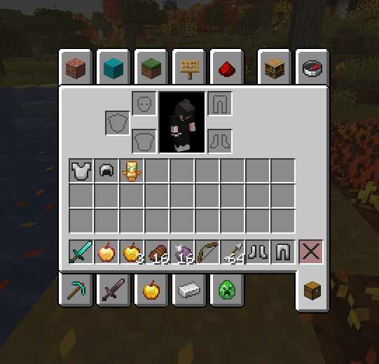
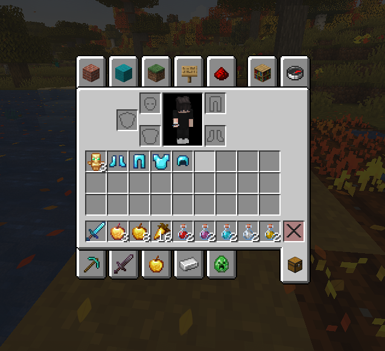
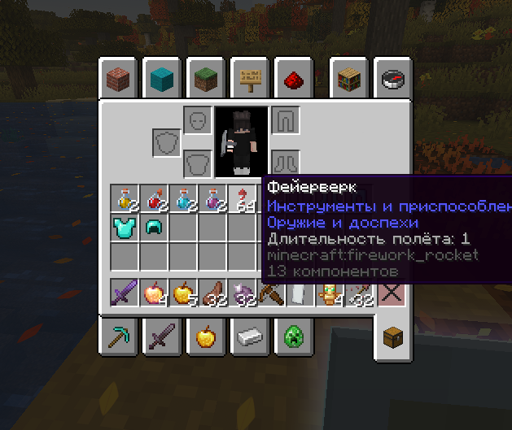
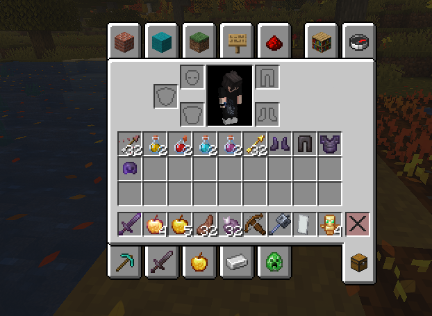
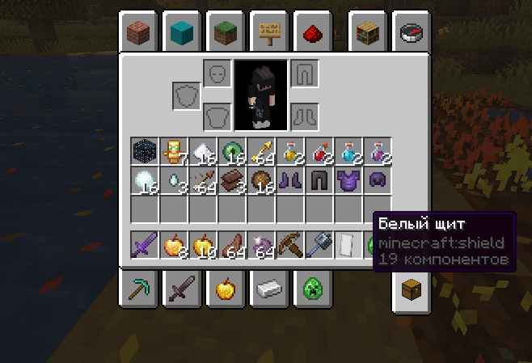

<!DOCTYPE html>
<html lang="ru">
<head>
    <meta charset="UTF-8">
    <meta name="viewport" content="width=device-width, initial-scale=1.0">
    <title>FunTime | Магазин привилегий</title>
    
</head>
<body>

    <h1>Магазин FunTime</h1>
    
Поддержи сервер и получи крутые плюшки!

    

        

            
            
Герой

            
14 ₽

            <a href="https://donatex.gg/donate/zwezdak22" class="btn-buy">Купить</a>
        

        

            
            
Барон

            
25 ₽

            <a href="https://donatex.gg/donate/zwezdak22" class="btn-buy">Купить</a>
        

        

            
            
Титан

            
50 ₽

            <a href="https://donatex.gg/donate/zwezdak22" class="btn-buy">Купить</a>
        

        

            
            
Принц

            
95 ₽

            <a href="https://donatex.gg/donate/zwezdak22" class="btn-buy">Купить</a>
        

        

            
            
Князь

            
150 ₽

            <a href="https://donatex.gg/donate/zwezdak22" class="btn-buy">Купить</a>
        

    

    

        <h2>💎 Калькулятор коинов</h2>
        
Введи сумму в рублях, чтобы узнать, сколько получишь коинов:

        <input type="number" id="rubInput" placeholder="Например: 500" oninput="calculateCoins()">
        
Ты получишь: 0 коинов

        
Курс: 1000 коинов = 100 рублей

    

    

        <h2>Просто хочешь поддержать проект?</h2>
        <a href="https://donatex.gg/donate/zwezdak22" class="btn-total">Поддержать</a>
        
После оплаты привилегия или коины будут выданы автоматически.

    

</body>
</html>
</script>

</body>
</html>
